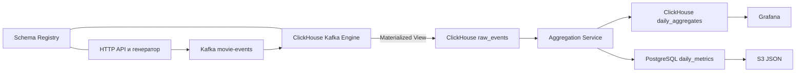

# Online Cinema · Event Streaming & Analytics

```sh
docker compose up
```

Для запуска нужны Docker с Linux-контейнерами и Docker Compose v2. При первом старте Compose скачивает образы и собирает Python-сервисы. Задача `database-init` применяет миграции ClickHouse и PostgreSQL. После неё запускаются агрегатор и Grafana. Задача `bootstrap` настраивает Kafka, регистрирует Avro-схему и создаёт таблицу Kafka Engine и представление для загрузки событий в ClickHouse. Продюсер запускается после `bootstrap`. Генератор публикует десять дней демонстрационной истории, затем продолжает создавать сессии. Дашборд заполнится после загрузки истории и ближайшего пересчёта.

| Компонент | Адрес |
| --- | --- |
| Дашборд Grafana | [Аналитика онлайн-кинотеатра](http://localhost:3000/d/cinema-analytics), доступен без входа |
| API продюсера | [OpenAPI](http://localhost:8000/docs) |
| API агрегации и экспорта | [OpenAPI](http://localhost:8001/docs) |
| Schema Registry | [Версии `movie-events-value`](http://localhost:8081/subjects/movie-events-value/versions) |
| ClickHouse HTTP | `http://localhost:8123`, `analytics` / `analytics` |
| SeaweedFS S3 | `http://localhost:8333`, `cinema-storage` / `cinema-storage-secret` |

## От события до метрик



Kafka работает на трёх брокерах KRaft. В `movie-events` три партиции, `replication.factor=3`, `min.insync.replicas=2`. После потери одного брокера остаётся кворум контроллеров и две копии данных. Продюсер использует `acks=all`, идемпотентную отправку и экспоненциальную задержку повторов. Ключ `user_id` направляет события пользователя в одну партицию, сохраняя порядок публикации его просмотров, пауз и завершений.

Karapace Schema Registry регистрирует схему [Avro v1](schemas/movie-event-v1.avsc) под `movie-events-value` с политикой `BACKWARD_TRANSITIVE`. Продюсер валидирует JSON и содержимое Avro, возвращает `201` после подтверждения Kafka, `422` при ошибке валидации и `503` при сбое публикации. Kafka Engine читает `AvroConfluent`. Материализованное представление помещает сообщения в `ReplacingMergeTree` с партицией по месяцу и ключом сортировки `(event_date, user_id, event_id)`. Запросы метрик используют `FINAL`, чтобы не учитывать повторную доставку одного события с теми же полями дважды.

```sh
curl -X POST http://localhost:8000/events -H 'Content-Type: application/json' -d '{"event_id":"3dcef5ab-0b75-4c35-b8e1-2718ffe2a637","user_id":"user-1","movie_id":"aurora","event_type":"VIEW_STARTED","timestamp":"2026-11-24T12:00:00Z","device_type":"TV","session_id":"session-1","progress_seconds":0}'
curl -X POST http://localhost:8001/aggregate/2026-11-24
curl -X POST http://localhost:8001/export/2026-11-24
```

Время события передаётся с часовым поясом и приводится к UTC. Поле `movie_id` ограничено 1024 байтами в UTF-8 и не допускает символ U+0000. Ранее загруженные события с такими идентификаторами учитываются в общих метриках, а их фильмы исключаются из топа. Для поиска и лайка генератор передаёт `progress_seconds=0`. При повторной отправке используйте исходный неизменный `event_id` и те же поля события. Для ручных запросов подставьте дату нужных событий. Экспорт ожидает, что агрегаты за эту дату уже посчитаны.

## Дневные агрегаты и экспорт

| Метрика | Определение |
| --- | --- |
| DAU | Число уникальных пользователей с любыми событиями за сутки UTC |
| Среднее время просмотра | Средний `progress_seconds` по `VIEW_FINISHED` |
| Топ фильмов | До десяти фильмов по числу `VIEW_STARTED` за сутки, при равенстве сортировка по `movie_id` |
| Конверсия | Число `VIEW_FINISHED`, делённое на число `VIEW_STARTED` за те же сутки |
| Retention после первого просмотра | Когорта формируется по дате первого `VIEW_STARTED` за всю доступную историю. D1 и D7 показывают долю пользователей когорты с любой активностью через один и семь дней. |
| Retention Cohort Heatmap | Когорта формируется по дате первого события любого типа. Day 0–7 показывает долю пользователей когорты с активностью в соответствующие сутки. Day 0 равен 100% для непустой когорты. |

Для отсутствующего знаменателя, отсутствия завершённых просмотров и незавершившихся дней retention значение хранится как `NULL`. Конверсия может превышать 100%, если часть завершившихся просмотров началась в предыдущие сутки.

Сервис хранит дневной снимок метрик в ClickHouse. Grafana читает эту таблицу через отдельного пользователя с правом `SELECT` и показывает цветовую таблицу когорт, DAU, конверсию и топ фильмов. В PostgreSQL дневной снимок обновляется транзакционно по ключу `(day, metric, movie_id)`, включая удаление фильмов, вышедших из топа. Пересчёт и экспорт одной даты используют общую блокировку PostgreSQL. При сбое между записями повторный пересчёт обновляет оба хранилища.

Планировщик пересчитывает текущий день и предыдущие 14 дней. Когорта остаётся в расписании как минимум до D+8, когда D7 уже можно зафиксировать. Планировщик также рассчитывает пропущенные исторические даты, за которые в ClickHouse есть события. Для обновления уже рассчитанной даты за пределами окна доступен ручной пересчёт.

После пересчёта планировщик отправляет готовые и изменившиеся снимки за завершённые сутки в `s3://movie-analytics/daily/YYYY-MM-DD/aggregates.json`. Файл содержит дату, значения метрик и время вычисления. При повторном экспорте используется тот же ключ. Планировщик повторит неудачные выгрузки в следующем цикле. Запросы ручной выгрузки сохраняются в отдельном томе до успешной записи, в том числе при недоступности PostgreSQL или S3.

| Переменная окружения | По умолчанию | Назначение |
| --- | --- | --- |
| `GENERATOR_ENABLED` | `true` | Включить демонстрационную историю и поток |
| `GENERATOR_INTERVAL_SECONDS` | `3` | Пауза между синтетическими сессиями |
| `AGGREGATION_INTERVAL_SECONDS` | `60` | Пауза между циклами фонового пересчёта и экспорта |
| `AGGREGATION_LOOKBACK_DAYS` | `14` | Число предыдущих дней для пересчёта, минимальное значение `7` дополняется одним днём для D7 |

Compose принимает эти переменные из окружения или `.env`. Для переопределения опубликованных портов доступны `PRODUCER_PORT`, `AGGREGATION_PORT`, `GRAFANA_PORT`, `REGISTRY_PORT`, `CLICKHOUSE_PORT` и `S3_PORT`.

## Проверки

```sh
python tests/run_integration.py
```

Команда требует Python 3 и Docker Compose с поддержкой `!reset`. Она создаёт отдельный Compose-проект с чистыми томами, без публикации портов и генерации демонстрационных событий. По завершении команда удаляет ресурсы своего проекта. Тесты сверяют все поля событий и ключ Kafka в ClickHouse, проверяют обе метрики retention, идемпотентность PostgreSQL, перезапись JSON в S3 и запросы Grafana.

Автономные тесты проверяют валидацию событий, кодирование Avro, синтетические сессии, пересчёт D7 и повторы выгрузки при сбоях PostgreSQL и S3.

```sh
docker compose run --build --rm --no-deps integration-tests python -m unittest discover -s tests -v
```

Эти команды проверяют доставку событий на запущенном стенде после остановки одного брокера и возвращают брокер в кластер.

```sh
docker compose stop kafka-1
docker compose run --rm --no-deps integration-tests python -m unittest -v tests.integration.IntegrationTests.test_event_round_trip
docker compose start kafka-1
```
