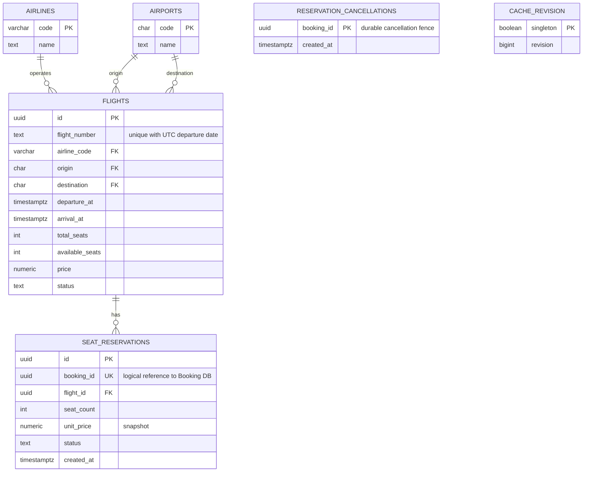
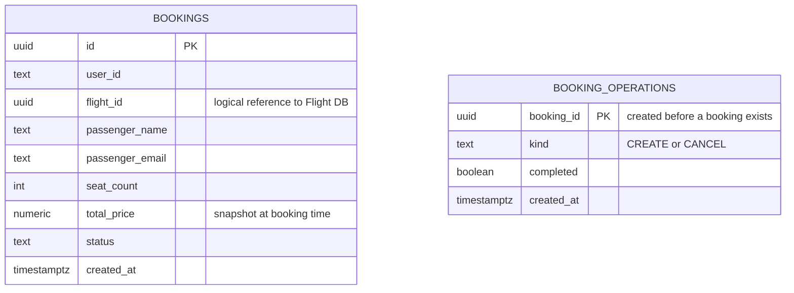

# ER-диаграммы и 3NF

## Flight PostgreSQL

## Booking PostgreSQL

Обе БД также содержат служебную `schema_migrations(version PK, checksum, applied_at)`.
Между независимыми БД нет физического foreign key: соответствие проверяется gRPC
и поддерживается протоколом компенсации. Operations и cancellation fences могут
существовать без Booking/SeatReservation, поэтому FK на них намеренно нет.

Атрибуты атомарны; все неключевые атрибуты зависят от ключа, всего ключа и только
ключа. Названия авиакомпаний и аэропортов вынесены в справочники; рейс не дублирует
их описания. Пассажир — снимок данных конкретного бронирования, а не профиль
пользователя: user_id не определяет имя или email пассажира. Стоимость бронирования
не выводится из текущей цены рейса: это исторический snapshot. Счётчик доступных
мест хранится согласно условию и меняется атомарно вместе с резервациями.

Ограничения SQL: `0 <= available_seats <= total_seats`, `total_seats > 0`,
`seat_count > 0`, цены > 0, `arrival_at > departure_at`, разные origin/destination,
IATA-коды `[A-Z]{3}`, уникальные `(flight_number, UTC departure date)` и
`seat_reservations.booking_id`, допустимые статусы и FK внутри Flight DB.
