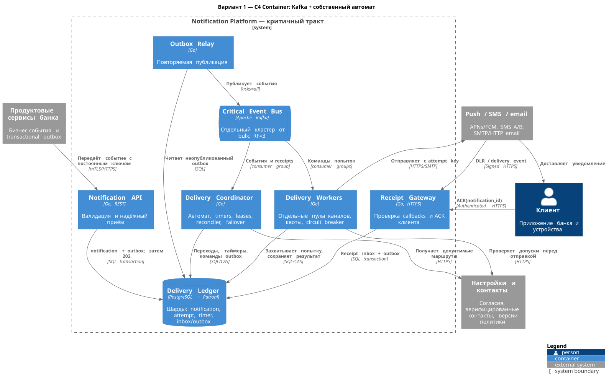
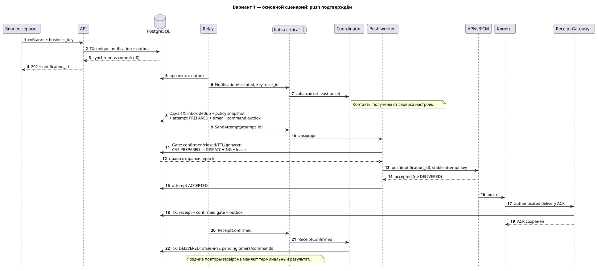
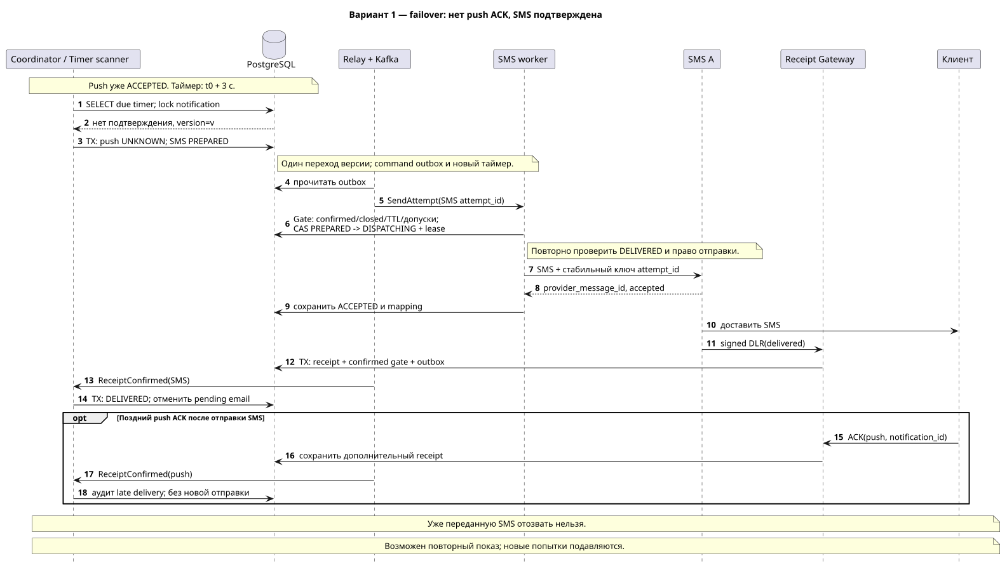
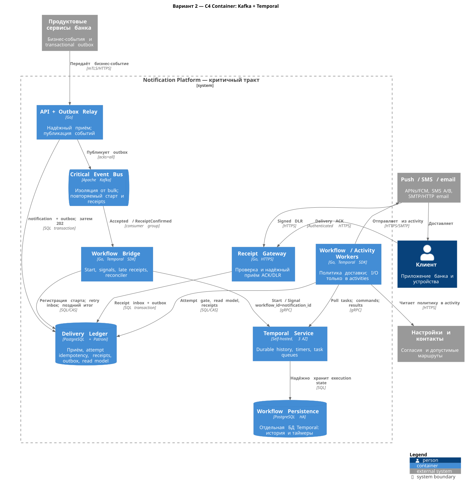
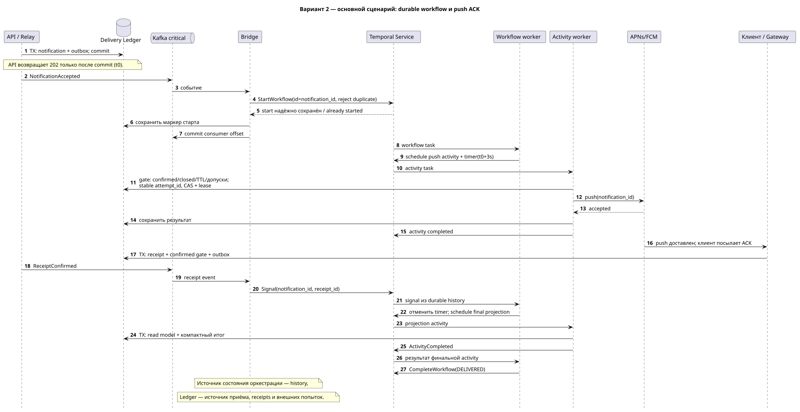
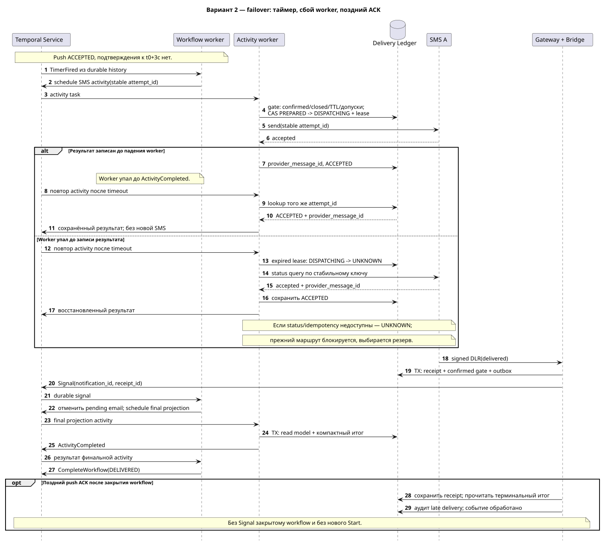

# RFC: Гарантированная доставка критичных уведомлений с кросс-канальным failover

| Метаданные | Значение |
|---|---|
| **Статус** | DESIGN — проект для архитектурного обсуждения |
| **Автор(ы)** | Автор учебного решения |
| **Ответственный** | Предлагаемая роль: технический лидер Notification Platform |
| **Бизнес-заказчик** | Предлагаемая роль: владелец клиентских коммуникаций онлайн-банка |
| **Ревьюеры** | Учебное архитектурное ревью: Codex, 2026-11-16. Согласование архитектурой, SRE, безопасностью и продуктом банка ещё требуется. |
| **Дата создания** | 2026-11-16 |
| **Дата обновления** | 2026-11-17 |

Вместо неизвестных имён сотрудников указаны роли; локальные обозначения будущих работ отдельно пояснены в разделе задач. Документ оформлен по заданному шаблону и содержит все обязательные разделы.

## Оглавление

1. [Контекст](#контекст)
2. [Продуктовый анализ](#продуктовый-анализ)
3. [Пользовательские сценарии](#пользовательские-сценарии)
4. [Статистика](#статистика)
5. [Требования](#требования)
6. [Варианты решения](#варианты-решения)
7. [Сравнительный анализ](#сравнительный-анализ)
8. [Выводы](#выводы)
9. [Связанные задачи](#связанные-задачи)
10. [Приложения](#приложения)

## Контекст

Сервисы онлайн-банка отправляют уведомления независимо. В результате нет единого владельца доставки, общей дедупликации и объяснимого статуса. При сбое провайдера команда может потерять сообщение или повторить его вслепую. Массовая реклама конкурирует с уведомлениями о деньгах.

Notification Platform становится обязательной точкой управления всеми уведомлениями. Этот RFC детализирует её подсистему критичной доставки: от надёжного принятия события до подтверждения хотя бы по одному из каналов push, SMS, email либо до явного разбора недоставки. Общеплатформенные требования и ASR определены в [решении заданий 1–7](solution.md).

**В области RFC:** приём, сохранность, маршрутизация, повторы, резервные провайдеры, кросс-канальное переключение, подтверждения, дедупликация, эксплуатация и миграция. Управление маркетинговыми кампаниями рассматривается только в части изоляции нагрузки и настроек. OTP и авторизация банковской операции требуют отдельной модели угроз и сюда не входят.

Ключевые вопросы: какое подтверждение считать доставкой; где хранить состояние и таймеры; как пережить неопределённый результат внешнего запроса; как обеспечить резерв без неконтролируемых дублей и затрат. Затронуты клиенты банка, продуктовые команды, поддержка, SRE и владельцы каналов.

### Что означает «гарантированная доставка»

Внутренняя гарантия и внешний результат разделены:

1. **Надёжное принятие:** `202 Accepted` возвращается только после фиксации события и ответственности за него в реплицируемом хранилище. С этого момента начинается `t0`.
2. **Сохранность:** принятые события не теряются при отказе одного узла/зоны. Если нужного кворума нет, приём возвращает ошибку, а отправитель сохраняет ответственность и повторяет с прежним ключом.
3. **Обработка:** для каждого принятого события есть состояние, следующий шаг или явная эскалация. «Забытое» сообщение без результата и без дальнейшего действия — дефект.
4. **Доставка:** фиксируется подтверждение хотя бы одного допустимого канала с указанием уровня доказательства. Наличие рабочего контакта и доступность маршрута — условия внешнего SLO, а не предположение об успешности любого запроса.
5. **Ограничение:** получение человеком и отсутствие любого повторного показа на независимых внешних каналах не гарантируются. Если все контакты недоступны, задача остаётся недоставленной, а не объявляется успешной ради метрики.

FCM отдельно различает принятие и доставку; статистика может поступать с большой задержкой. Поэтому аналитические отчёты FCM не используются как оперативный индивидуальный ACK для трёхсекундного таймера. APNs описан как best-effort сервис. Это ограничивает обещания платформы. [Документация FCM](https://firebase.google.com/docs/cloud-messaging/understand-delivery), [документация APNs](https://developer.apple.com/documentation/usernotifications/sending-notification-requests-to-apns).

## Продуктовый анализ

| Цель | Определение результата | Как проверяем |
|---|---|---|
| B1: retention +15% | Относительный рост D30 retention: `R_new / R_base − 1 ≥0,15`. D30 — доля пользователей когорты, совершивших заранее определённое целевое действие на 30-й день после входа в когорту. Например, 40% →46%, а не 55%. | До запуска фиксируются событие активности, базовый период, размер выборки и минимальный эффект. Рандомизированный эксперимент; не менее 30 дней наблюдения каждой когорты. Критичная доставка одинакова в обеих группах; проверяются новые правила сервисных/маркетинговых коммуникаций. |
| B2: жалобы −30% | Снижение частоты жалоб на уведомления на 1 000 активных клиентов за месяц: `C_new / C_base ≤0,70`, при одинаковой классификации жалоб. | Сравнение когорт и причин жалоб; дополнительно жалобы на 10 000 доставок, доля отказов от маркетинга и дубли. Снижение числа отправок не должно маскировать недоставку critical. |
| B3: надёжная доставка | Сохранность принятого critical и выполнение NFR3; все недоставленные сообщения обнаружимы. | Сквозные SLI, тесты отказов, отчёт всех принятых событий, разбор каждого длительно недоставленного critical. |

Централизация создаёт условия для B1/B2, но сама не доказывает рост retention. Предпочтения, ограничение маркетинговой частоты и понятная история снижают раздражение; быстрая информация о деньгах повышает доверие. Для критичных событий надёжность важнее обычного SMS-бюджета.

**Правила каналов.** По умолчанию push → SMS → email. Если пользователь выбрал SMS, начинаем с SMS; push остаётся допустимым резервом. Отключённый необязательный канал не включается автоматически. Полное отключение обязательной категории недоступно в продукте; технически запрещённый push или непроверенный контакт пропускается. Если пользователь имеет только один действующий контакт, число резервов объективно ограничено.

**Минимизация данных.** В push/SMS/email передаётся короткий нейтральный текст и безопасная ссылка на приложение без секретов в URL. Подробности операции и полные реквизиты показываются после аутентификации. Изменение телефона/email проходит отдельную проверку банка.

## Пользовательские сценарии

| Приоритет | Тип сценария | Действующее лицо | Сценарий |
|---|---|---|---|
| MUST HAVE | Основная доставка | Клиент | После списания получает push; приложение подтверждает получение, резервные отправки прекращаются. |
| MUST HAVE | Межканальный failover | Клиент | Push запрещён ОС или не подтверждён до дедлайна; банк отправляет SMS на проверенный номер, при необходимости использует email. |
| MUST HAVE | Предпочтение | Клиент | Выбирает SMS основным для обязательной категории; политика начинает с SMS и использует только допустимые резервы. |
| MUST HAVE | Дедупликация | Продуктовая команда | Повторяет запрос после сетевой ошибки; получает прежний `notification_id`, новое уведомление не создаётся. |
| MUST HAVE | Неопределённый результат | Платформа | SMS-провайдер мог принять запрос до обрыва соединения; платформа запрашивает статус или повторяет тот же ключ, а не создаёт новую SMS вслепую. |
| MUST HAVE | Недоставка | Дежурный / поддержка | Видит critical без подтверждения дольше 60 с; при исчерпании каналов получает раннюю эскалацию, после 24 ч — обязательную задачу разбора. |
| MUST HAVE | Настройки | Клиент | Отказывается от маркетинга; ещё не начатые отправки кампании прекращаются в пределах 5 с. Критичная доставка продолжается. |
| MUST HAVE | Одновременная нагрузка | Клиент и маркетолог | Кампания на 1 млн адресатов не ухудшает бюджет задержки уведомления о переводе. |
| SHOULD HAVE | Прозрачность | Клиент / поддержка | Видит историю; поддержка объясняет, какой канал использован и почему был резерв, без раскрытия лишних данных. |
| COULD HAVE | Оптимизация | Владелец платформы | Меняет порядок равноценных провайдеров по наблюдаемой надёжности и цене через версионированную политику и ограниченный эксперимент. |

MUST HAVE — обязательное условие запуска; SHOULD HAVE — желательное; COULD HAVE — дополнительная возможность после выполнения базовых гарантий.

## Статистика

### Исходные данные и трактовка

Задание даёт MAU=10 млн, DAU=3 млн, 300 000 одновременных пользователей и дневной профиль 2/3/5 уведомлений по категориям. Не указано, относится ли профиль к DAU или ко всему MAU. Основной расчёт выполнен по DAU; верхняя оценка по MAU защищает от недооценки. Одновременные пользователи сами по себе не задают RPS: нужна частота операций.

| Показатель | Базовый сценарий: 3 млн DAU | Консервативный: 10 млн получателей в день |
|---|---:|---:|
| Critical / сутки | 6 млн | 20 млн |
| Service / сутки | 9 млн | 30 млн |
| Marketing, входящие намерения / сутки | 15 млн | 50 млн |
| Всего / сутки | 30 млн | 100 млн |
| Средний новый поток / с, деление на 86 400 | 347,2 | 1 157,4 |
| Средний critical / с | 69,4 | 231,5 |

Профиль 5 маркетинговых сообщений — оценка входящих намерений до проверки согласий и лимита FR7. Расчёт не предполагает, что все 5 будут отправлены.

### Расчёт нагрузок и резервов

Проектные множители пика, не полученные из замеров: **×6** для общего потока, **×8** для critical. Дополнительную кампанию считаем поверх фонового потока, хотя часть кампаний уже могла входить в средние значения.

```text
Кампания 1 млн за 15 мин:    1 000 000 / 900 ≈ 1 111 новых задач/с.
Общий верхний пик:          100 000 000 / 86 400 × 6 + 1 111 ≈ 8 056/с.
Верхний critical-пик:       20 000 000 / 86 400 × 8 ≈ 1 852/с.
Выбранный envelope:         10 000 новых/с, в том числе 2 000 critical/с.
Постоянная ёмкость:         3 000 новых/с; пик 10 000/с длится 15 мин.
При 1,25 попытки/сообщение:  12 500 исходящих попыток/с на общем пике.
Отдельный стресс-профиль:   50 000 событий попыток/подтверждений в секунду.
```

Новый запрос, внешняя попытка и запись в Kafka — разные единицы. При 6–10 внутренних событиях на уведомление пик даёт 60–100 тыс. записей Kafka/с ещё до аварийной лавины. Предварительная цель стенда — до 200 тыс. внутренних записей/с суммарно; это гипотеза для измерения, а не паспортная характеристика Kafka.

Если provider request занимает в среднем 200 мс, для 12 500 запросов/с требуется около `12 500 ×0,2 =2 500` одновременно выполняемых запросов; с двойным запасом — около 5 000. На недоступный канал не открывается бесконечное число соединений: используются timeout, ограниченные пулы и circuit breaker.

При потере push весь critical-пик может потребовать 2 000 SMS/с. Необходима **проверенная доступная квота 2 500 SMS/с у каждого из двух резервирующих провайдеров**, если требуется переживать ещё и отказ одного из них. Это два заранее согласованных лимита, а не предположение, что сумма малых квот достаточна. Прогрев, лимиты оператора и антифрод проверяются до запуска.

60 секунд остановки critical при 2 000/с дают backlog 120 000 сообщений. Внутренний тракт проектируется на восстановительную обработку 4 000 critical/с: при входе 2 000/с очередь разберётся примерно за 60 с. Это требует отдельного теста и соответствующих квот **канала**; при доступности только SMS с лимитом 2 500/с разбор займёт около 240 с. RTO означает возобновление обработки, а не мгновенное выполнение просроченного внешнего SLO.

### Хранение: порядок величин

Допущения: событие=1 KiB, коэффициент служебных накладных расходов Kafka=1,2, replication factor=3; горячая запись состояния с попытками=2 KiB в среднем, индексы/накладные расходы БД=×2, три физические копии; компактная запись дедупликации с ID, hash и итогом=256 B до индексов; аудит=8 переходов по 256 B, то есть 2 KiB на логическое сообщение в штатном профиле. Аварийные повторы увеличивают эти средние размеры и проверяются отдельно.

| Хранилище | Базовая оценка | Верхняя оценка |
|---|---:|---:|
| Входящие события Kafka, 3 суток, 3 копии | `30 млн ×1 KiB ×3 ×1,2 ×3` ≈332 GB | ≈1,11 TB |
| Горячие состояния, 7 суток, индексы и 3 копии | `30 млн ×7 ×2 KiB ×2 ×3` ≈2,58 TB | ≈8,60 TB |
| Записи дедупликации, 35 суток, индексы и 3 копии | `30 млн ×35 ×256 B ×2 ×3` ≈1,61 TB | ≈5,38 TB |
| Псевдонимизированный аудит, 180 суток, до избыточности | `30 млн ×180 ×2 KiB` ≈11,06 TB | ≈36,86 TB |

Здесь GB/TB — десятичные единицы, KiB=1 024 B. Kafka-строка учитывает только входящий поток, **не все** команды и receipts. При усилении ×8 рабочий бюджет Kafka за три суток — около 2,7/8,9 TB соответственно. Резерв свободного места ≥30%, резервные копии и накладные расходы архивного хранилища добавляются отдельно. Полный текст сообщений хранится отдельно в зашифрованном виде с коротким TTL, не размножается в событиях.

Стартовая гипотеза — 8 шардов Ledger: 4 выделенных critical и 4 bulk, каждый с тремя узлами по AZ. Каталог категории выбирает пул, затем `hash(user_id)` — шард внутри пула; категория бизнес-события неизменна при replay. При 2 000 critical/с каждый critical primary получает около 500 новых сообщений/с **плюс** переходы, попытки и receipts. Внутри шарда — временные разделы для удаления старого состояния; компактные ключи имеют отдельный срок хранения. Число шардов и диски уточняются испытаниями; отчёты не выполняют тяжёлые запросы по рабочим primary.

Для варианта 2 дополнительно нужны история и visibility Temporal. Только critical: 6/20 млн workflow/сутки. При условных 30 событиях истории по 0,5 KiB это 92/307 GB в сутки **до** индексов и репликации. Retention=3 суток отсчитывается **после закрытия** workflow: закрытая история занимает около 0,83/2,76 TB при трёх копиях; до суток открытых workflow добавляют ещё до 0,28/0,92 TB в этой модели. Итого — около 1,11/3,69 TB до индексов, visibility, аварийного роста числа событий и запаса. История не бесплатна. [Retention Temporal](https://docs.temporal.io/temporal-service/temporal-server).

### Стоимость

Для сравнения используются **условные**, не рыночные тарифы: push=0,001; SMS=0,8; email=0,01 денежной единицы за оплачиваемую попытку. Модель push-first: 90% имеют ACK до 3 с, 10% требуют SMS, 0,5% всех сообщений доходят до email. Предполагается одна оплачиваемая попытка каждого достигнутого канала; повторы и резервный SMS-провайдер считаются дополнительно. Это проектная модель ветвлений, не наблюдаемая статистика и не доказательство независимости отказов.

```text
E(cost) = 1×0,001 + 0,10×0,8 + 0,005×0,01 = 0,08105 / critical.
Для 6 млн critical/сутки: ≈486 300 условных единиц.
Только SMS:               6 млн ×0,8 =4 800 000.
Условная экономия:        около 90% переменных расходов.
```

Модель соответствует NFR10 при указанном профиле ACK и отсутствии дополнительных платных попыток. Доступный push или ACK на пятой секунде сами по себе не обеспечивают экономию: резерв уже стартует на третьей. Например, при 80% ACK до 3 с расчётная цена растёт примерно до 0,161 за сообщение. Пользовательский выбор SMS первым и аварии анализируются отдельно и в общей сумме. Экономия выше относится только к переменным отправкам, без инфраструктуры, хранения и команды. Бюджет не блокирует обязательную доставку; тревога запускает действия дежурного и согласование дополнительного резерва.

## Требования

### Функциональные требования

Общие FR1–FR12 действуют из [раздела 1 решения](solution.md#1-функциональные-требования). Для подсистемы они уточняются следующими проверяемыми сценариями.

| № | Приоритет | Обозначение | Требование и критерий приёмки | Основание |
|---|---|---|---|---|
| 1 | MUST | DFR1 | Повтор события с тем же ключом возвращает прежний идентификатор; изменение содержимого под тем же ключом отклоняется как конфликт. | FR1, FR5 |
| 2 | MUST | DFR2 | Выбирается упорядоченный список допустимых каналов и контактов с учётом обязательности и предпочтений. Непроверенные/недоступные контакты пропускаются с причиной. | FR2–FR4 |
| 3 | MUST | DFR3 | Временная ошибка вызывает ограниченный повтор; постоянная ошибка или истечение окна подтверждения запускают резерв. Отсутствие ACK не считается доказательством отказа. | FR2, FR8, FR12 |
| 4 | MUST | DFR4 | Подтверждение любого канала прекращает ещё не начатые отправки; дубли и поздние callbacks сохраняются без повторного запуска. | FR5, FR12 |
| 5 | MUST | DFR5 | После сбоя процесса или зоны восстанавливаются незавершённые события, попытки и ожидания; перезапуск не создаёт новый бизнес-идентификатор. | FR1, FR8 |
| 6 | MUST | DFR6 | По идентификатору доступны история попыток, уровень подтверждения, причина failover и расходы. Недоставленные сообщения видны дежурному. | FR6, FR10 |
| 7 | MUST | DFR7 | Критичные сообщения не содержат маркетинга; правила каналов и шаблоны изменяются только уполномоченными сотрудниками с аудитом. | FR3, FR9, FR11 |

### Нефункциональные требования и ASR

NFR1–NFR11 не переопределяются: действуют точные метрики из [раздела 2 решения](solution.md#2-нефункциональные-требования). Наиболее важные критерии RFC:

| № | Приоритет | Обозначение | Критерий |
|---|---|---|---|
| 1 | MUST | NFR1, NFR2 | Приём ≥99,95%; p99 приёма ≤200 мс; p99 первой отправки ≤2 с. |
| 2 | MUST | NFR3 | Условный внешний SLO: 99% онлайн-push ≤5 с, 99,9% подтверждаемых доступных маршрутов ≤60 с, 99,99% ≤24 ч; параллельно открытый SLI по всем critical. |
| 3 | MUST | NFR4 | RPO=0 и RTO≤60 с при потере узла/зоны; региональный DR: RPO≤5 мин, RTO≤30 мин. |
| 4 | MUST | NFR5, NFR6 | 10 000 новых/с, включая 2 000 critical/с; стресс 50 000 событий попыток/ACK в секунду; дедупликация 35 суток. |
| 5 | MUST | NFR7–NFR9 | Свежесть настроек ≤5 с; мониторинг с лагом ≤30 с; обнаружение ≤1 мин; TLS, шифрование, ролевой аудит, отсутствие чувствительных данных в логах. |
| 6 | SHOULD | NFR10 | В когорте push-first с ≥90% ACK до 3 с доля уведомлений с SMS ≤10%, средняя условная цена всех попыток ≤0,10; аварийное превышение допустимо ради надёжности. |
| 7 | MUST | NFR11 | Горячее состояние завершённых сообщений 7 суток от принятия, дедупликация 35, псевдонимизированный аудит 180; незавершённые обязательства не удаляются; квартальная проверка восстановления. |

Расчёты нагрузок приведены в разделе [«Статистика»](#статистика). Приоритеты ASR1–ASR5 — **P0**; для ASR6 наблюдаемость — **P0**, экономия — **P1**. ASR1 связывает FR2/NFR2/NFR5; ASR2 — FR2/FR8/FR12/NFR1/NFR3/NFR4; ASR3 — FR5/FR12/NFR6; ASR4 — FR7/NFR5/NFR11; ASR5 — FR3/FR4/FR9/FR11/NFR7/NFR9; ASR6 — FR6/FR10/NFR8/NFR10. Обоснование архитектурной значимости находится в [разделе 3 решения](solution.md#3-архитектурно-значимые-требования--asr).

### Подтверждения и границы измерения

| Канал | Что считается подтверждённой доставкой | Что не является таким подтверждением |
|---|---|---|
| Push | Индивидуальный аутентифицированный ACK приложения/SDK, связанный с `notification_id`, с уровнем `DEVICE_RECEIVED`. Если ОС не даёт приложению вовремя отправить ACK, результат остаётся неизвестным. | HTTP success от APNs/FCM, запись в истории банка, агрегированная статистика. |
| SMS | Подписанный DLR `delivered` от провайдера, с уровнем `CARRIER_CONFIRMED` или `HANDSET_CONFIRMED`, если он действительно доступен. Возможности фиксируются для каждого маршрута. | `queued`, `accepted`, `sent`; отсутствие отрицательного DLR. |
| Email | Подтверждение принимающей почтовой системы от провайдера, уровень `MAIL_SERVER_ACCEPTED`; отдельно возможен добровольный ACK в приложении. | Принятие запроса API отправителя; отсутствие bounce. Пиксель открытия не считается надёжным ACK. |

SMS-статусы `sent` и `delivered` имеют разную семантику; даже `delivered` не доказывает прочтение человеком. Документация конкретного провайдера служит образцом контракта, а не выбором доступного банку поставщика. [Twilio Message Status](https://www.twilio.com/docs/messaging/api/message-resource).

Составной показатель называется «подтверждённая доставка по контракту канала», а уровни не смешиваются в отчёте о получении устройством. Если заказчик требует только `DEVICE_RECEIVED/HANDSET_CONFIRMED`, email и часть SMS-маршрутов перестают закрывать этот SLO — это отдельное продуктовое решение до запуска.

SLI использует `confirmed_at − accepted_at` по серверным часам; время клиента и дата DLR сохраняются только для диагностики. Доля без подтверждения включает неизвестный результат. Когорту доступных маршрутов проверяют по верификации контактов, состоянию устройства/тестовым ACK и независимым пробам провайдера; отсутствие доставки само по себе не основание исключать событие. Рядом всегда публикуются числитель и знаменатель для всех принятых сообщений и причины исключения из условного SLO. Время от банковской операции до `t0` измеряется отдельно, чтобы задержка у источника не исчезла из общей картины.

Для NFR6 отдельно измеряются: (а) повторные логические записи/команды по одному ключу; (б) сообщения с подтверждением двух разных внешних попыток; (в) повторные показы в инструментированной когорте, включая тестовые устройства. Только (в) измеряет показ; DLR или приём письма сервером его не доказывают. Значение «0 дублей» без достаточного покрытия телеметрией не считается выполнением SLO по показам. Пользовательский READ — отдельный ACK, автоматический DEVICE_RECEIVED не требует нажатия и не отмечает сообщение прочитанным.

### Общая политика доставки для обоих вариантов

Версия маршрутизации фиксируется при старте; перед каждой отправкой проверяются свежие допустимость контакта и настройки. Если недоступны предпочтения, critical может использовать последний снимок обязательной политики. Но статус безопасности контакта проверяется отдельно: нужен доступ к реестру отозванных контактов либо его реплика со свежестью ≤5 с. Если безопасность контакта подтвердить нельзя, этот маршрут приостанавливается, выбирается другой проверенный контакт и при необходимости создаётся эскалация. Маркетинг приостанавливается и при недоступности проверки согласия. Старый снимок не разрешает отправку на потенциально отозванный номер; эта зависимость включается в SLO и тесты отказов.

| Момент / условие | Действие |
|---|---|
| `t0…t0+2 с` | Отправить основной канал; для штатного порядка — push. Если токена нет или канал заведомо недоступен, сразу перейти к следующему. HTTP connect timeout=300 мс, общий request timeout=1 с. |
| До `t0+3 с` | Ждать индивидуальный push ACK. Один быстрый повтор допустим только при известном отказе до принятия и наличии времени; не продлевать дедлайн каждым повтором. |
| `t0+3 с` без ACK либо постоянный отказ push | Отметить результат push как UNKNOWN/FAILED и подготовить SMS A. Отрицательный ответ запускает резерв немедленно. |
| SMS A явно отвергла запрос / отрицательный DLR | При наличии бюджета времени переключиться на SMS B. Это резерв **провайдера внутри канала**, а не кросс-канальный failover. |
| SMS принята, но DLR ещё нет | Ждать до `t0+15 с`. При сетевом UNKNOWN сначала запросить статус по ключу/ID; без идемпотентности не отправлять вторую SMS вслепую. |
| `t0+15 с` без подтверждения | Запрос статуса с бюджетом ≤1 с; затем подготовить email, если нет положительного результата. Неопределённая SMS может прийти позднее — риск учитывается. |
| До `t0+45 с` | Ждать подтверждение email/любой более ранней попытки; резерв времени до 60 с оставлен на задержки, обработку callbacks и краткий повтор известного отказа. |
| `t0+60 с` без подтверждения | Флаг OVERDUE, тревога по правилам инцидента, сохранение незавершённой задачи. Повторы продолжаются в пределах TTL. |
| До 24 ч | Всего ≤20 вызовов отправки: до 6 в первую минуту, 11 зарезервированы на отметки 5/15/30 мин, 1/2/4/8/12/16/20 ч и 23 ч 45 мин; ещё 3 — на событие восстановления канала. В каждом позднем окне не более одного вызова; повторы с прежним ключом также расходуют лимит. Jitter 0–30 с не переносит попытку за TTL. Слоты с открытым circuit breaker не вызывают провайдера. UNKNOWN не повторяется без подтверждённо безопасного способа. |
| Все контакты невалидны либо попытки исчерпаны | Эскалация сразу; не ждать 24 ч. При достижении 24 ч — обязательный разбор, автоматические отправки останавливаются. Поздние receipts всё равно сохраняются. |

Если основной канал не push, применяются его окна: SMS ожидается до 15 с от `t0`, затем выбирается следующий допустимый маршрут; email как основной ожидается не более 15 с до резерва. Уже использованный маршрут не повторяется как «новый канал». Все окна ограничены абсолютными дедлайнами и общим TTL, а не суммируются бесконечно.

Резерв поздних попыток нельзя израсходовать ранним циклом retries: обычный exponential backoff с максимумом 20 попыток мог бы закончиться задолго до 24 ч. Status query имеет отдельный лимит — не чаще одного на попытку за 30 с и в пределах квоты провайдера; проверки прекращаются при подтверждении/эскалации. Пробы circuit breaker общие для маршрута, а не для каждого ожидающего сообщения. Наличие рабочего канала только в момент последней секунды TTL не означает гарантированного выполнения 24-часового SLO; восстановление маршрута и время, оставшееся на доставку, учитываются в испытаниях.

Circuit breaker отдельно на `(канал, провайдер, регион)`: например, ≥50% ошибок в последних 100 запросах за 10 с открывают его на 30 с, затем допускаются ограниченные пробы. Это стартовые настройки для испытаний. Тайм-аут считается UNKNOWN, а не доказанным отказом; HTTP 429 учитывает Retry-After, но не задерживает обязательный резерв за его дедлайн. Постоянная ошибка контакта не повторяется. Резервные квоты critical не расходуются массовой рекламой.

### Идентификаторы, состояния и предотвращение дублей

**Бизнес-ключ:** `(producer_id, business_event_id, user_id, notification_kind)`. Источник фиксирует ID вместе с банковской операцией в своём transactional outbox. Повтор обязан использовать тот же ID; разная операция и разные этапы одной операции получают разные business_event_id. Для многопользовательского события получатель входит в ключ.

Платформа создаёт `notification_id`, сохраняет hash содержимого и уникальный бизнес-ключ. Тот же ключ и тот же hash возвращают прежний результат; тот же ключ и другой hash — `409 Conflict`. Удержание ключа 35 суток покрывает максимальный автоматический replay источника 30 суток. После 30 суток replay производится только управляемой процедурой; бесконтрольный replay после очистки ключа может создать дубль. Удаление временных партиций не разрушает дедупликацию: компактный ключ хранится отдельно, с собственным сроком и уникальностью в шарде пользователя.

Компактная запись содержит fingerprint бизнес-ключа, исходный `notification_id`, hash канонических параметров/версии шаблона, `accepted_at`, `expires_at`, итог и признак закрытия. Она сохраняется 35 суток от первого принятия; корректный повтор не продлевает TTL. После очистки подробностей на седьмой день повтор всё ещё возвращает прежний ID и итог, а отличающееся содержимое — 409. Ключи незавершённых сообщений и открытых эскалаций закрепляются до разрешения. Псевдонимизированный аудит доступен только по роли: отсутствие телефона/email не делает связанные через ID события анонимными.

Состояние сообщения: `ACCEPTED → IN_PROGRESS → DELIVERED` либо `ESCALATED_UNDELIVERED`. `OVERDUE` — дополнительный флаг, не причина прекращать обработку. Эскалация может получить отметку `LATE_DELIVERED` после подлинного позднего подтверждения; это не исправляет уже нарушенный SLO. У сообщения есть версия для атомарного сравнения и замены (CAS).

Состояние попытки: `PREPARED → DISPATCHING → ACCEPTED → CONFIRMED`; альтернативы `FAILED`, `UNKNOWN`, `CANCELLED`. Ретрай сетевого вызова использует тот же `attempt_id` и ключ провайдера. Новая попытка создаётся только решением оркестратора, с отдельным номером и учётом лимита. Уникальность `(notification_id, channel, provider, attempt_no)` и частичное ограничение активной попытки по маршруту защищают от конкуренции workers. Нельзя объявить UNKNOWN попытку безопасно отменённой, если внешний запрос уже начался.

Право отправки имеет `lease_until` и `epoch`. Если worker исчез после DISPATCHING, истечение lease переводит попытку в UNKNOWN, а не обратно в PREPARED. В варианте 1 это делает durable scanner; в варианте 2 — повтор activity через общий gate. Далее выполняется status query, возврат сохранённого результата или повтор **того же** ключа в пределах идемпотентности провайдера. Без этих возможностей новая отправка по прежнему маршруту блокируется; оркестратор выбирает другой канал либо эскалацию. UNKNOWN удерживает запрет на новую попытку того же маршрута до выяснения; при этом следующий канал не блокируется. Просроченный worker не получает новое право, а его запоздалый подтверждённый внешний результат всё равно сохраняется как receipt. Значение lease для PoC — 2 с при HTTP timeout=1 с; его истечение не доказывает отсутствие внешнего эффекта.

Переходы монотонны по силе доказательства: поздний HTTP-ответ `accepted`, ошибка или отрицательный callback не перезаписывают уже подтверждённую доставку. Если receipt пришёл до ответа отправки, сопоставленная попытка сразу может стать CONFIRMED; последующая запись sender только дополняет provider ID и аудит. Обновления выполняются с проверкой версии/допустимого исходного состояния, без безусловной перезаписи статуса.

| Уровень | Защита | Остаточная граница |
|---|---|---|
| Повтор входного события | UNIQUE бизнес-ключ + hash | Источник должен сохранять стабильный ID; горизонт гарантии — 35 суток. |
| Повтор команды / конкурентные таймеры | Inbox dedup, row lock/CAS, уникальный маршрут | Старый worker может уже выполнять внешний запрос. |
| Повтор внешней попытки | Стабильный provider idempotency key, сохранённый provider ID, status query | Работает только в пределах документированного окна идемпотентности провайдера. При его отсутствии exactly-once внешнего эффекта нет. |
| Повтор callback | UNIQUE `(provider, receipt_id)` либо канонический hash при отсутствии ID; проверка подписи | Повтор не запускает новый failover и не откатывает подтверждённое состояние. |
| Повтор push в приложении | Клиентский кеш обработанных `notification_id`, сверка статуса перед управляемым показом | Нельзя гарантированно подавить уже показанный ОС push или отменить принятую SMS. |

Перед внешним вызовом worker атомарно проверяет отсутствие подтверждения/закрытия, `now < expires_at`, бюджет попыток, актуальные допуски контакта и epoch, затем переводит PREPARED→DISPATCHING. Подтверждение, закрытие и захват отправки сериализуются на одной записи сообщения. Если ACK или TTL победили, отправка не начинается; если DISPATCHING уже зафиксирован, внешний вызов может завершиться позднее. Блокировка БД не удерживается на время сети. Между commit и внешним вызовом остаётся окно неопределённости; провайдерский ключ уменьшает, но не устраняет его.

В обоих вариантах Receipt Gateway в одной транзакции сохраняет проверенный и сопоставленный положительный receipt, ставит в записи сообщения `delivery_confirmed=true` и записывает outbox. Отправляющий gate и обработчик таймера проверяют этот флаг под той же блокировкой, не дожидаясь доставки события через Kafka. Итоговое состояние/проекция затем достраивается оркестратором. Непроверенный или ещё не сопоставленный callback не имеет права устанавливать флаг. Так задержка обработки receipt не превращается в окно для новой резервной отправки.

**Ключевой компромисс:** отсутствие ACK к дедлайну не означает отсутствие доставки. Приоритет — успеть уведомить о деньгах; поэтому резерв запускается и при UNKNOWN. Если push уже показан, а ACK потерян, клиент может получить и SMS. Полностью исключить это и одновременно гарантировать быструю доставку нельзя. Таймер, короткий TTL push, дедупликация и отмена ещё не начатого резерва снижают вероятность, а метрика NFR6 показывает остаток. TTL/collapse-key провайдера не рассматриваются как доказательство единственного показа.

### Данные, интерфейсы и надёжная передача ответственности

`POST /v1/notifications` принимает бизнес-ключ, получателя, тип события, ссылку на утверждённый шаблон, параметры и срок актуальности. Тип critical разрешён только доверенным источникам и каталогу обязательных событий. Коды: 202 — надёжно сохранено, 409 — конфликт ключа, 400/422 — невалидные данные, 401/403 — нет полномочий. Для 429 до начала транзакции приём не состоялся; 503, timeout или потеря ответа означают **неизвестный результат**: commit мог успеть выполниться. Источник сохраняет событие и повторяет тот же ключ до достоверного ответа. Ответ на корректный повтор содержит тот же ID и текущий либо сохранённый итоговый статус. `GET /v1/notifications/{id}` доступен по роли/принадлежности пользователю. Для critical `expires_at` задаётся каталогом события как `t0+24 ч`; вызывающая команда не может сократить этот срок произвольно.

Основные сущности: `notification`, `attempt`, `receipt_inbox`, `event_outbox`, `dedup_key`, `policy_version`, `audit_event`; в варианте 1 дополнительно `delivery_timer`. Телефон/email представлены ссылкой на защищённое контактное хранилище. Публичные callbacks проверяют подпись, provider account, соответствие ID, допустимый переход и ограничения от replay; клиентский ACK связан с аутентифицированным пользователем и его устройством. Receipt сохраняется **до** HTTP success провайдеру/клиенту.

У источника банковская операция и исходящий outbox фиксируются в одной транзакции. У платформы принятие и новый outbox также атомарны. Relay отмечает запись опубликованной только после ACK Kafka. Сбой между публикацией и отметкой даёт повтор, который обрабатывается inbox dedup. Долгоживущий outbox не очищается по Kafka-retention: очищаются только подтверждённо опубликованные записи, а зависшие вызывают тревогу. Подтверждённое принятие нельзя связывать только с временной очередью в памяти API.

ACK брокера подтверждает публикацию, но не передачу ответственности исполнителю. Ledger-reconciler каждые 5 с выбирает ACCEPTED без зарегистрированного владельца обработки: для варианта 1 повторно публикует стартовое событие, для варианта 2 инициирует идемпотентный Start через Bridge. Маркер владения фиксируется вместе с первым состоянием/таймером либо после подтверждённого старта workflow. Так старт восстанавливается и после истечения Kafka retention. Аналогично PREPARED без продвижения повторно выдаётся с тем же attempt ID; DISPATCHING восстанавливается только через UNKNOWN. После TTL reconciler создаёт эскалацию вместо устаревшей отправки. Активные записи и неразрешённые обязательства не удаляются только потому, что outbox уже опубликован.

## Варианты решения

Оба варианта используют одинаковые продуктовые правила, контактный сервис, защищённые шаблоны, наблюдаемость, ограничения внешней доставки и отдельный bulk-тракт. Отличие — кто надёжно исполняет оркестрацию и таймеры. Версии технологий фиксируются перед PoC из поддерживаемых релизов; номера патчей не являются архитектурным требованием.

### Вариант 1: Kafka + PostgreSQL + собственный автомат доставки

> **Описание:** очередь событий отделяет приём от обработки; состояние сообщения, таймеры и право отправки управляются небольшим явным автоматом в PostgreSQL.

#### Архитектура



[Исходник C4 Container, PlantUML](diagrams/v1-container.puml). Граница диаграммы — критичный тракт платформы; сервис настроек и контактов, источники банка и внешние каналы показаны соседними системами. Service/marketing работают в отдельных пулах и Kafka-кластере; их внутренности и система телеметрии опущены для читаемости.

**Конкретные технологии:** Go для API/workers; Apache Kafka для событий и команд; PostgreSQL с Patroni и etcd для состояния и автоматического failover; Kubernetes для размещения в трёх AZ; OpenTelemetry Collector, Prometheus, Grafana и Tempo для наблюдаемости; S3-совместимое объектное хранилище для псевдонимизированного аудита. Redis допускается как необязательный кеш и ограничитель частоты, но не хранит единственную копию задания и не является единственной защитой отправки.

Kafka critical физически отделена от bulk: 3 брокера по зонам как минимальная отказоустойчивая конфигурация, начальные 48 partitions для critical с ключом `user_id`; число брокеров/partitions повышается по результатам теста. Для topics: RF=3, `min.insync.replicas=2`, producer `acks=all`, идемпотентный producer, запрет unclean leader election. При недостаточном ISR записи не подтверждаются. Эти настройки повышают долговечность журнала, но не означают единственную SMS у клиента. [Kafka topic configuration](https://kafka.apache.org/42/configuration/topic-configs/).

PostgreSQL каждого шарда: primary и две реплики по зонам; `synchronous_commit=on`, синхронное подтверждение минимум от одной реплики в другой AZ, строгий режим без автоматического перехода к асинхронному commit. Patroni должен продвигать только подходящую синхронную реплику; etcd-кворум и fencing старого primary предотвращают split-brain. Синхронная репликация повышает сохранность ценой ожидания и возможной остановки записи. [PostgreSQL synchronous replication](https://www.postgresql.org/docs/current/warm-standby.html#SYNCHRONOUS-REPLICATION).

Coordinator обрабатывает событие и одной SQL-транзакцией обновляет версию сообщения, сохраняет попытку, таймер и outbox-команду. Kafka offset подтверждается только после commit; повтор безопасен. Таймеры хранят `due_at`, индексируются и сканируются пакетами с `FOR UPDATE SKIP LOCKED` каждые 100 мс, с ограниченным batch. Worker не держит поток спящим на каждое сообщение. После рестарта scanner выбирает просроченные записи; конкурентные scanners не создают второй переход благодаря блокировке и версии.

Команды на внешнюю отправку проходят через outbox и отдельные consumer groups по каналам. Каждый sender перед отправкой выполняет атомарный gate в Ledger. Lease и epoch помогают отсеять старый worker перед вызовом, но сами не отменяют уже начатый внешний эффект. Источник истины о состоянии — PostgreSQL; Kafka обеспечивает доставку событий/команд и replay.

#### Sequence Diagram: основной сценарий



[PlantUML основного сценария](diagrams/v1-main.puml). Приём завершён после synchronous commit; push HTTP success ещё не завершает уведомление. После индивидуального ACK Coordinator фиксирует DELIVERED и отменяет ожидающие резервы.

#### Sequence Diagram: failover



[PlantUML сценария failover](diagrams/v1-failover.puml). Таймер и ACK конкурируют через одну запись состояния. Если SMS уже началась, поздний push ACK сохраняется, но не может отозвать SMS. При явном отказе SMS A возможен SMS B; при UNKNOWN предпочтителен status query, затем другой канал.

#### Соответствие каждому ASR

| ASR | Как выполняется | Чем доказывается |
|---|---|---|
| ASR1, P0 | Отдельный critical Kafka-кластер, пулы workers/БД/соединений и резерв провайдерских квот; короткий путь до первой отправки. | Кампания 1 млн одновременно с 2 000 critical/с; p99≤2 с. |
| ASR2, P0 | Синхронный Ledger, transactional outbox, durable timers, retry и резервные каналы/провайдеры. | Отказ процесса/primary/AZ в каждой точке; 0 потерянных accepted, RTO≤60 с; внешний SLO проверяется отдельно. |
| ASR3, P0 | UNIQUE бизнес-ключ, CAS/row lock, inbox callbacks, стабильный attempt key и проверка перед отправкой. | Конкурентные таймеры и ACK, replay, падение после внешнего success; подсчёт дублей с учётом описанной границы. |
| ASR4, P0 | Шарды PostgreSQL, partitions Kafka, горизонтальные workers, дозированный fanout bulk, лимиты retry. | 10 000 новых/с 15 мин, 50 000 событий попыток/ACK в секунду; объём горячих данных и скорость очистки. |
| ASR5, P0 | Политики/контакты проверяются перед отправкой; авторизация и аудит; минимум PII, шифрование. | Отзыв согласия ≤5 с, недоступность policy service, попытки неразрешённого critical, проверка логов и доступа. |
| ASR6, P0/P1 | Обязательный аудит и тревоги (P0); метрики backlog, DLR, SLO и цены; push-first для экономии (P1). | Задержка метрик≤30 с, тревога≤2 мин, расчёт цены на стандартном профиле. |

Это проектное соответствие, а не утверждение, что система уже прошла испытания.

#### Этапы реализации

| Этап | Описание | Планируемый срок | Ресурсы | Риски |
|---|---|---|---|---|
| 1 | Контракты ID/ACK, PoC таймеров и провайдерской идемпотентности; уточнение потока | Недели 1–2 | 2 backend, 0,5 SRE, QA | Не окажется своевременного ACK или резервной квоты |
| 2 | Надёжный приём, outbox, Kafka, Ledger, автомат и 3 адаптера | Недели 3–5 | 3 backend, SRE, QA | Ошибки переходов и неопределённых результатов |
| 3 | Отказы AZ, нагрузка, защита данных, runbooks и сверка аудита | Недели 6–7 | 3 backend, SRE, QA, безопасность | SQL bottleneck, всплеск SMS |
| 4 | Canary, переход источников и стабилизация | Недели 8–9 | Та же команда, владельцы источников | Одновременная отправка старым и новым трактом |

#### Преимущества

- Модель явно отражает бизнес-состояние; статус и право отправки лежат в одном Ledger.
- Используются распространённые Kafka/PostgreSQL и небольшой фиксированный набор шагов.
- Нет дополнительной истории workflow на каждое critical; проще оценивать объём хранения.

#### Недостатки

- Команда самостоятельно отвечает за корректность таймеров, lease, CAS, повторов и их миграций.
- PostgreSQL становится чувствительной точкой по write throughput; нужны шарды, индексы и регулярное обслуживание.
- Сложное развитие сценариев может превратить небольшой автомат в дорогое собственное workflow-ядро.

### Вариант 2: Kafka + Temporal для durable workflow

> **Описание:** каждому критичному уведомлению соответствует workflow с постоянным ID; Temporal хранит историю, таймеры и задания. Kafka остаётся надёжным входом платформы, а Ledger защищает внешние отправки и хранит приём/receipts.

#### Архитектура



[Исходник C4 Container, PlantUML](diagrams/v2-container.puml). Сохраняются отдельные bulk-пулы и critical Kafka-кластер. Task queues Temporal разделяются по critical workflow и delivery activities каждого канала; сами очереди без выделенных workers/квот не обеспечивают изоляцию.

**Конкретные технологии:** Go и Temporal Go SDK; self-hosted Temporal Service в трёх AZ; отдельный PostgreSQL HA для persistence/visibility Temporal; Apache Kafka как входной event bus; PostgreSQL+Patroni для Delivery Ledger; Kubernetes, OpenTelemetry, Prometheus, Grafana, Tempo и S3-совместимый архив. Kafka и Ledger используют те же настройки сохранности, что вариант 1. PostgreSQL Temporal также требует синхронной репликации и корректного failover: durable engine поверх ненадёжного хранилища не даёт RPO=0.

API сначала фиксирует notification+outbox в Ledger. Bridge читает Kafka и вызывает `StartWorkflow` с `workflow_id=notification_id` и запретом повторного старта уже существующего ID в доступном горизонте истории. Offset подтверждается только после надёжного старта или ответа «уже запущен». Сбой между стартом и offset безопасен. После очистки Temporal history дедупликацию продолжает обеспечивать Ledger: входной replay с завершённым бизнес-ключом не запускает новый workflow. По истечении 35 суток применяется управляемый replay, как в варианте 1.

Workflow хранит порядок каналов и абсолютные дедлайны. Сеть, обращения к настройкам и БД выполняются только в activities. Изменение кода сопровождается поддержкой старых workflow и контролем детерминированного replay. Восстановление workflow на основе истории — свойство Temporal; оно не заменяет идемпотентность внешнего API. [Temporal workflow history and replay](https://docs.temporal.io/workflows).

У каждой отправки стабильный `attempt_id`, не зависящий от случайного нового запуска worker. Activity использует общий атомарный attempt gate в Ledger. Если результат уже записан, повтор возвращает его без новой отправки. Если после внешнего success activity/worker упал **до** записи результата, сохраняется та же UNKNOWN-проблема: требуется ключ провайдера или status query. Temporal прямо рекомендует идемпотентные activities, потому что выполнение может повториться. [Temporal activity idempotency](https://docs.temporal.io/activity-definition).

Receipt Gateway надёжно записывает callback в Ledger/outbox, затем Bridge посылает Signal **открытому** workflow. Если старт ещё не состоялся или Temporal временно недоступен, receipt переносится в durable retry inbox с `next_attempt_at`; Kafka offset фиксируется после этой записи, чтобы не блокировать partition. Если workflow уже закрыт штатно, Bridge сохраняет late receipt, обновляет итог/аудит в Ledger и завершает обработку события **без** повторного старта или SignalWithStart. Для неожиданного FAILED/TERMINATED при активном Ledger создаётся инцидент и управляемое восстановление с теми же ID и проверкой attempt gate. Одного NotFound недостаточно: сверяются регистрация старта, закрытие в history и компактный итог Ledger. [Temporal: сообщения принимаются только открытым workflow](https://docs.temporal.io/develop/java/nexus/development-walkthrough/add-messaging).

Повторные signals дедуплицируются по receipt ID. Быстрый callback может прийти до записи provider_message_id: клиентская ссылка/attempt key позволяет сопоставление; иначе receipt сохраняется как orphan и повторно сопоставляется с ограниченным интервалом до TTL и далее передаётся на разбор. Для поздних callbacks после очистки горячих данных индекс связи provider ID с notification ID сохраняется в защищённом архиве на 35 суток; его объём учитывается в накладных расходах аудита. Непроверенный callback не может изменять итог.

**Граница источников истины:** история Temporal владеет оркестрацией и таймерами; Ledger — приёмом, receipts и внешними попытками, а статус поддержки является проекцией. После ACK Gateway ставит запрет новых отправок. Workflow получает Signal, отменяет pending-резервы, выполняет и дожидается идемпотентной финальной activity записи итога в Ledger, затем завершается. После закрытия новая activity не планируется. Поздние receipts обрабатываются Bridge отдельно, не меняя закрытую историю; дополнительная отметка LATE_DELIVERED не скрывает прошлую просрочку. Reconciler проверяет открытые обязательства и согласованность проекции; второй независимый автомат таймеров в Ledger не вводится.

Чтобы retries SDK не спорили с кросс-канальной политикой, внешняя activity имеет короткий StartToClose timeout, ограниченный ScheduleToClose и явную классификацию ошибок. Технические повторы безопасной/idempotent activity не создают новую бизнес-попытку; решение о новом канале принадлежит workflow. Отмена activity — запрос, а не гарантированная отмена уже переданной SMS.

#### Sequence Diagram: основной сценарий



[PlantUML основного сценария](diagrams/v2-main.puml). История содержит старт, планирование, таймер и Signal. Workflow завершает ожидание по ACK; read model обновляется отдельно и может кратковременно отставать.

#### Sequence Diagram: failover



[PlantUML сценария failover](diagrams/v2-failover.puml). Durable timer запускает SMS. После падения worker повтор activity возвращает сохранённый результат. Окно между внешним success и сохранением результата остаётся и разобрано отдельно.

#### Соответствие каждому ASR

| ASR | Как выполняется | Чем доказывается |
|---|---|---|
| ASR1, P0 | Выделенные critical task queues/workers, Kafka и квоты; ограниченные activities и абсолютные deadlines. | Измерить p99 от `t0`, включая Kafka→Bridge→Temporal→activity, одновременно с bulk-кампанией. Дополнительные переходы могут исчерпать бюджет. |
| ASR2, P0 | Durable history/timers плюс синхронная persistence, outbox и надёжные signals; workflow восстанавливается после падения worker. | Отказ workers/Temporal nodes/primary/AZ; сохранность accepted и стартов; RTO≤60 с. |
| ASR3, P0 | Постоянный workflow ID, dedup Ledger, идемпотентные activities и receipts, тот же gate внешней попытки. | Replay/повтор signals, истечение activity timeout после success и удаление history; внешний exactly-once не предполагается. |
| ASR4, P0 | Горизонтальное масштабирование workers и Temporal history services, разделение namespace/task queues и bulk; расчёт persistence. | 2 000 новых workflow/с, стресс receipts, число ожидающих timers, объём истории и скорость её очистки. |
| ASR5, P0 | Политики читаются в activity; в history только ID/защищённые ссылки, чувствительные payload при необходимости шифруются codec; доступ к Temporal UI ограничен. | Отзыв настроек≤5 с, аудит UI/БД/history, отсутствие PII в ошибках и search attributes. |
| ASR6, P0/P1 | History, аудит и тревоги обязательны (P0); сквозные IDs объединяют workflow, Ledger и провайдера; экономия каналов имеет P1. | SLO метрик и тревог, reconciler read model, стоимость истории и внешних отправок. |

Вариант реализует ASR концептуально, но требует отдельного доказательства latency и throughput на выбранном deployment Temporal; наличие движка само по себе их не гарантирует.

#### Этапы реализации

| Этап | Описание | Планируемый срок | Ресурсы | Риски |
|---|---|---|---|---|
| 1 | PoC throughput, durable timers, activity idempotency и версия workflow | Недели 1–3 | 2 backend, SRE, QA | Не выполнен p99 или недооценена persistence |
| 2 | Temporal HA, Bridge, workflows, Ledger/gates и адаптеры | Недели 4–7 | 3 backend, SRE с опытом Temporal, QA | Двойные состояния, неверные retries, сложность HA |
| 3 | Нагрузка, replay старых workflow, отказ AZ и security review | Недели 8–9 | Та же команда, безопасность | Неработоспособность старой истории после обновления |
| 4 | Canary и миграция источников | Недели 10–11 | Та же команда и владельцы источников | Сигналы до старта/после закрытия, отставание проекции |

#### Преимущества

- Таймеры, история ожиданий и восстановление исполнения предоставляются готовым workflow engine.
- Проще добавлять длительные ветвления и видеть последовательность шагов одного сообщения.
- Падение worker не требует собственного механизма восстановления всех ожиданий.

#### Недостатки

- Дополнительная распределённая система, persistence и компетенции дежурства.
- Миллионы workflow создают значительный поток истории; latency длиннее по числу переходов.
- Нужны детерминированный replay, миграции workflow и согласование read model.
- Идемпотентность провайдера, UNKNOWN и поздние дубли остаются задачами приложения.

## Сравнительный анализ

### Ресурсные требования

Оценки сроков — предварительные для команды, уже умеющей эксплуатировать Go/Kafka/PostgreSQL, но не имеющей production Temporal. Это явно принятое организационное допущение, а не факт о банке.

| Критерий | Вариант 1 | Вариант 2 |
|---|---|---|
| Время реализации | Около 9 недель | Около 11 недель при освоении Temporal |
| Команда | 3 backend, 1 SRE, 1 QA; участие безопасности и владельцев каналов | Аналогичная команда, нужен опыт Temporal или дополнительное обучение |
| Общая инфраструктура | Отдельные critical/bulk Kafka, Ledger HA, workers, observability, архив | Та же |
| Дополнительная инфраструктура | Scanner таймеров и координатор; собственное сопровождение автомата | Temporal frontend/history/matching services, отдельная HA persistence/visibility |
| Начальный sizing стенда | API 6×(2 vCPU/4 GiB), coordinator 6×(2/4), channel workers 12×(2/4); Kafka critical 3×(8 vCPU/32 GiB); Ledger — 8 шардов по 3 узла, старт 8 vCPU/32 GiB на узел | Общие API/канальные workers сохраняются; coordinator заменяется workflow workers; дополнительно Temporal services 6×(4 vCPU/8 GiB) и persistence 3×(16 vCPU/64 GiB) как старт PoC |
| Организационный риск | Недооценить корректность собственного автомата | Освоить новый runtime и дежурство; ошибки workflow versioning |
| Основной компромисс | Меньше компонентов, больше собственной логики надёжности | Готовая durable-оркестрация, больше инфраструктуры и хранения |

Sizing — отправная точка испытаний, а не доказанная достаточная конфигурация или смета закупки. Узлы critical не делят ресурсные лимиты с bulk; диски выбираются по приведённому расчёту хранения, write IOPS и запасу, а не только CPU/RAM.

### Соответствие требованиям

«Проектно» означает наличие конкретного механизма с обязательным подтверждением на PoC. Одинаковые внешние ограничения перечислены выше и не скрыты отметкой соответствия.

| Требование | Вариант 1 | Вариант 2 |
|---|---|---|
| FR1–FR3, FR8: приём, обязательность и резерв | Проектно: API, автомат и durable timers | Проектно: API, workflow и timers Temporal |
| FR4, FR7: настройки и bulk | Общий сервис настроек и изолированный bulk-тракт | Тот же; bulk не создаёт critical workflow |
| FR5, FR12: дедупликация, ACK | UNIQUE/CAS/gates; внешние ограничения сохраняются | Workflow ID + тот же Ledger/gates; внешние ограничения сохраняются |
| FR6, FR10: история и отчёты | Ledger + псевдонимизированный аудит | History + Ledger projection + аудит |
| FR9, FR11: шаблоны и полномочия | Общие версионированные шаблоны, роли и аудит | То же, дополнительно защита workflow history/UI |
| NFR1–NFR2 / ASR1: доступность и задержка | Меньше внутренних переходов; измерить p99 | Больше переходов; выше риск бюджета 2 с, необходим тест |
| NFR3–NFR4 / ASR2: доставка и восстановление | Собственные таймеры + HA; тест отказов | Durable timers + HA persistence; тест отказов |
| NFR5, NFR11 / ASR4: масштаб и хранение | Шарды и partitions, уборка состояния | То же плюс scaling history/visibility и retention workflow |
| NFR6 / ASR3: дубли | Управляемая дедупликация, не внешний exactly-once | Та же граница, activity может исполняться повторно |
| NFR7, NFR9 / ASR5: настройки и безопасность | Проверка перед отправкой, шифрование/роли | То же плюс защита history/search attributes |
| NFR8, NFR10 / ASR6: наблюдаемость и цена | Общая телеметрия, экономичная политика | То же плюс метрики runtime и стоимость history |

### Почему не выбран третий упрощённый путь

Синхронный API «сразу вызови провайдера» проще на старте, но не закрывает разрыв между банковской операцией и отправкой, восстановление ожиданий и изоляцию нагрузки. Параллельная отправка во все каналы снижает ожидание резерва ценой систематических дублей и полного SMS-бюджета. Эти варианты нарушают ASR1/ASR2 и ASR3/ASR6 соответственно, поэтому не рассматриваются как кандидаты промышленного решения.

## Выводы

> **Рекомендация:** вариант 1 — Kafka + PostgreSQL с явным автоматом доставки, при условии успешных нагрузочных и отказных испытаний.

Для фиксированного сценария из трёх каналов и ограниченного набора таймеров собственный автомат достаточно мал, а стабильная модель Ledger позволяет проверять состояние и право отправки одной транзакцией. При принятом опыте команды это уменьшает число новых эксплуатационных компонентов и объём дополнительной истории на миллионы critical в сутки. Выбор не основан на предположении, что PostgreSQL автоматически выдержит любой поток: PoC таймеров, шардов и отказа зоны — блокирующие задачи.

Принятые компромиссы: команда владеет корректностью автомата; подтверждения разных каналов имеют разные уровни; быстрый failover при UNKNOWN оставляет риск позднего дубля; при аварии бюджет SMS уступает надёжности. Зональная RPO=0 не распространяется автоматически на потерю региона: при текущем асинхронном DR остаётся RPO≤5 мин. Если бизнес требует RPO=0 и для региона, нужно синхронное межрегиональное принятие и новый расчёт задержки/доступности до утверждения RFC.

Вариант 2 становится предпочтительным, если банк уже эксплуатирует Temporal, сценарии разрастаются до длительных многошаговых процессов либо стоимость поддержки собственного автомата превысит стоимость runtime. Его выбирают только после подтверждения 2 000 стартов workflow/с, p99 и стоимости persistence на реальном профиле.

### Региональное восстановление

RTO≤30 мин требует заранее подготовленного резервного региона с ёмкостью critical, конфигурацией, ключами и доступом к провайдерам. Ledger, контактные допуски, архив/WAL и, для варианта 2, persistence Temporal реплицируются асинхронно; контролируется единая восстанавливаемая точка не старше 5 мин. При выходе её задержки за бюджет RPO новые подтверждения приёма critical приостанавливаются, пока гарантия не восстановлена. Один лишь ежедневный backup не удовлетворяет NFR4.

Перед активацией резерва старый регион блокируется от внешних отправок; история, Ledger и receipts сверяются, незавершённые задания восстанавливаются с теми же ID. Несовпадение записей о внешней отправке трактуется как UNKNOWN, а не разрешение послать сообщение заново. В варианте 2 согласованность точек Ledger/persistence и восстановление workflows проверяются отдельным учением. Потеря последних ≤5 мин остаётся допустимым ограничением этого DR; его нельзя представлять как зональную RPO=0.

### Наблюдаемость и эксплуатация выбранного решения

- **Метрики:** accepted rate, возраст source/outbox/Kafka backlog, latency первой отправки, ACK/DLR latency и coverage, failover по причинам, UNKNOWN, просрочка, retries, дубли, доступность политики/контактов, цена и доля SMS. Знаменатели — отдельно все принятые и подтверждаемые доступные маршруты.
- **Алерты:** старейший critical без прогресса >10 с; устойчивое нарушение бюджета очереди >1 мин; accepted без подтверждения >60 с; синхронная реплика недоступна; outbox не публикуется; circuit breaker открыт; SMS-квота/цена близки к пределу. Отдельное сообщение в дежурную систему отправляется независимым от неисправного канала путём.
- **Корреляция:** `notification_id`, `attempt_id`, `receipt_id`, `policy_version` и `trace_id` в событиях и защищённых логах. Эти высококардинальные ID не используются как labels Prometheus; метрики агрегируются по категории/каналу/провайдеру/результату.
- **Runbooks:** отказ провайдера, рост UNKNOWN, потеря AZ, недоступность контактов, перегрузка и исчерпание бюджета. При отказе сначала ограничивается bulk; critical не удаляются из backlog и не отмечаются доставленными без доказательства.
- **Разбор:** автоматическая сверка `accepted = delivered + active + escalated` по каждому окну и shard; незавершённое сообщение обязано иметь следующий due_at либо владельца эскалации. Для Temporal статус сверяется также с workflow history.

### Отказные случаи, которые должны переживаться

| Точка отказа | Восстановление |
|---|---|
| Источник упал после банковской операции | Его transactional outbox повторяет событие; API-дедупликация возвращает прежний ID. |
| API закоммитил, но ответ потерян | Повтор с тем же business key возвращает прежнюю запись. |
| Relay опубликовал, но не отметил outbox | Повтор события поглощается inbox/UNIQUE; бизнес-переход не повторяется. |
| Coordinator упал после commit, до offset | Повтор Kafka безопасен; таймер и команда уже в БД. |
| Sender упал после внешнего success | Сохранённый результат используется повторно; если его нет, status query/тот же ключ провайдера, иначе UNKNOWN и явный остаточный риск. |
| Sender упал после claim до сети, либо истёк lease | DISPATCHING→UNKNOWN; выяснение результата и безопасный повтор прежнего ключа либо другой канал. Безусловного возврата в PREPARED нет. |
| Стартовое событие удалено по Kafka retention до обработки | Reconciler восстанавливает handoff из ACCEPTED с прежним ID; после TTL — эскалация, а не отправка. |
| Callback пришёл закрытому workflow | Receipt и поздний итог сохраняются в Ledger; Bridge завершает событие без бесконечных Signal retries и без рестарта отправки. |
| DLR раньше ответа send или пришёл дважды | Receipt хранится независимо и сопоставляется повторно; подпись и дедупликация исключают повторный переход. |
| Поздний ACK пересёкся с failover | Атомарный gate останавливает PREPARED, DISPATCHING может закончиться; поздний результат учитывается без новых попыток. |
| Kafka недоступна после `202` | Событие остаётся в Ledger/outbox; растёт видимый backlog. Сохранность не нарушена, latency SLO может нарушиться. |
| Потеря primary/AZ | Корректный quorum/fencing и продвижение синхронной реплики; возобновление scanner/workers. RPO/RTO доказываются испытанием. |
| Все контакты недоступны | Нет ложного DELIVERED: ранняя эскалация, история и последующий разбор; физическая доставка не обещается. |

### План проверки и критерии запуска

| Проверка | Обязательный результат |
|---|---|
| Нормальный push, SMS-first, отсутствие токена, недействительный номер, email-only | Верный порядок, уровень подтверждения и причина пропуска; отсутствие ложного успеха. |
| 100 конкурентных повторов одного ключа и конфликт содержимого | Один notification; прежний ID; 409 для отличающегося payload. |
| ACK одновременно с timer; duplicate/out-of-order callbacks; ACK до ответа send | Согласованное состояние, отсутствие дополнительной логической отправки, сохранённый аудит. |
| Падение в каждой точке таблицы отказов, включая UNKNOWN провайдера | Все accepted учтены; безопасный повтор или явная неопределённость; нет молчаливой потери. |
| 3 000 новых/с постоянно, 10 000/с 15 мин; отдельно 2 000 critical/с + кампания 1 млн | Метрики NFR2/NFR5, отсутствие вытеснения critical, достаточные квоты. Затем стресс 50 000 событий попыток/ACK в секунду и проверка восстановления backlog. |
| Отключение push и затем одного SMS-провайдера | Рабочая резервная квота, контролируемая цена и внешний SLO на подтверждаемом маршруте. |
| Потеря AZ и восстановление из backup / региональный DR | RPO=0/RTO≤60 с для AZ; региональные RPO≤5 мин/RTO≤30 мин измерены отдельно. |
| Отзыв настроек и security review | Применение ≤5 с, маркетинг приостанавливается при сбое проверки, роли и журналы соответствуют NFR9. |
| Проверка хранения и replay границ | Горячие данные/ключи/аудит удаляются по TTL; replay≤30 суток безопасен, старый требует управляемой процедуры. |
| Повтор на восьмые сутки после очистки горячих данных | Прежний ID/итог из compact record; 409 при изменённом содержимом; открытая эскалация не удалена. |
| Длительный отказ с восстановлением через 12 ч | Зарезервированные поздние попытки не потрачены раньше; отправка возобновляется, TTL и лимит 20 соблюдаются. |
| Истечение Kafka retention, crash после claim, late Signal после completion | Reconciler восстанавливает старт/UNKNOWN; Bridge не блокирует partition и не запускает закрытый workflow заново. |

SLO 99,99% за 24 ч нельзя подтвердить коротким демо. После стенда нужен пилот с достаточным числом сообщений, измерением доверительных интервалов и анализом всех пропусков. До получения данных значения остаются целями, а не фактическими гарантиями подрядчика.

### Миграция и откат

Сначала один продуктовый источник публикует события в теневой режим: платформа принимает и строит план, но внешние отправки выполняет только старый тракт. Сверяются полнота, настройки и ожидаемые расходы. Затем по стабильному хешу получателя включается canary 1%→10%→50%→100%.

Право фактической отправки в каждый момент принадлежит ровно одному тракту. Источник выбирает владельца через централизованный флаг и общий business ID; принятые новым трактом сообщения завершает новый тракт. При откате новые события маршрутизируются старому владельцу, а принятые события не дублируются массовым replay. Если критичный дефект требует перевода незавершённых событий, производится управляемая передача с теми же ID и сверкой attempts/receipts; слепой повтор запрещён.

Переход к следующему проценту допускается после достаточного окна наблюдения, сверки принятых событий, метрик задержки/подтверждения и отсутствия необъяснённых дублей. Старые прямые отправки отключаются по источникам с запретом новых обходных интеграций.

## Связанные задачи

Идентификаторы ниже — локальные обозначения работ для декомпозиции RFC, не существующие задачи внешнего трекера.

| ID | Работа | Зависимость / результат |
|---|---|---|
| NP-01 | Зафиксировать обязательные категории, уровни подтверждения, сроки хранения и региональный RPO | До утверждения контрактов; владелец продукта + безопасность |
| NP-02 | Измерить входной поток и доступность контактов, уточнить DAU/MAU | До окончательного sizing |
| NP-03 | Проверить провайдерские ключи, DLR, независимость маршрутов и резервные 2 500 SMS/с | Блокирует обещания failover и дублей |
| NP-04 | Реализовать PoC обоих вариантов на общем профиле | Доказательство latency, throughput и стоимости; выбор подтверждается данными |
| NP-05 | Контракт business ID, source outbox и Notification API | После NP-01; основа сохранности и дедупликации |
| NP-06 | Ledger, автомат, durable timers и надёжный outbox выбранного варианта | После NP-04/05 |
| NP-07 | Адаптеры push/SMS/email, callback/ACK, attempt gate | После NP-03/05, параллельно NP-06 |
| NP-08 | Политики/шаблоны, свежесть настроек, безопасность | До canary |
| NP-09 | Observability, reconciler, нагрузка, fault injection и DR | До промышленного допуска |
| NP-10 | Canary, миграция источников и вывод прямых отправок | После NP-06–09; согласованный владелец отправки |

## Приложения

### Диаграммы

Все изображения сохранены локально; доступ к серверу диаграмм для чтения RFC не нужен. Рядом находятся редактируемые исходники PlantUML. C4-диаграммы используют стандартную библиотеку C4-PlantUML. [Библиотека C4-PlantUML](https://github.com/plantuml-stdlib/C4-PlantUML).

| Вариант | C4 Container | Основной сценарий | Failover |
|---|---|---|---|
| 1 | [SVG](diagrams/v1-container.svg) / [PlantUML](diagrams/v1-container.puml) | [SVG](diagrams/v1-main.svg) / [PlantUML](diagrams/v1-main.puml) | [SVG](diagrams/v1-failover.svg) / [PlantUML](diagrams/v1-failover.puml) |
| 2 | [SVG](diagrams/v2-container.svg) / [PlantUML](diagrams/v2-container.puml) | [SVG](diagrams/v2-main.svg) / [PlantUML](diagrams/v2-main.puml) | [SVG](diagrams/v2-failover.svg) / [PlantUML](diagrams/v2-failover.puml) |

Для повторного рендеринга используйте сохранённые исходники `.puml` в PlantUML. Готовые SVG позволяют изучать результат без установки дополнительных инструментов. [Документация PlantUML Server](https://plantuml.com/server).

### Глоссарий

| Термин | Определение |
|---|---|
| ASR | Требование, которое существенно определяет архитектуру системы. |
| SLI / SLO / SLA | Наблюдаемая метрика / целевое значение / договорное обязательство с последствиями. В RFC заданы SLO; SLA провайдеров ещё нужно согласовать. |
| Failover | Переключение на резервный канал либо провайдера при отказе или отсутствии достаточного подтверждения в отведённое время. |
| ACK / DLR | Подтверждение получения / отчёт провайдера о результате доставки. Их доказательная сила зависит от канала. |
| Idempotency | Повтор операции с тем же ключом не создаёт дополнительного логического эффекта в оговорённых границах. |
| At-least-once | Событие/задание может быть обработано более одного раза; получатель обязан выдерживать повтор. |
| Outbox / inbox | Сохранение исходящего события в транзакции с состоянием / учёт уже обработанных входящих событий. |
| CAS | Изменение состояния только при совпадении ожидаемой версии. |
| UNKNOWN | Неизвестно, состоялся ли внешний эффект; нельзя приравнивать к FAILED. |
| RPO / RTO | Допустимая потеря данных по времени / время восстановления обслуживания для заданной модели отказа. |
| AZ | Зона доступности с независимыми отказами в пределах региона. |
| Backpressure | Ограничение приёма/обработки менее приоритетной нагрузки, чтобы не перегрузить зависимость. |
| Circuit breaker | Временное прекращение обычных запросов к неработающей зависимости с ограниченными пробами восстановления. |
